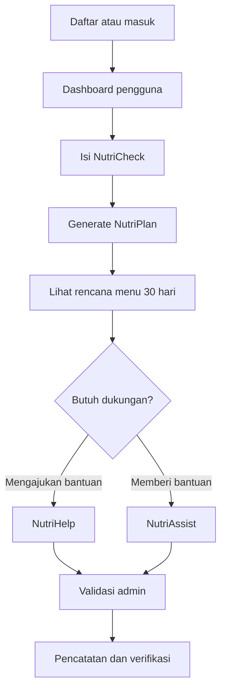

<div align="center">

# NutrimateAI

### Pendamping nutrisi untuk ibu dan si kecil

Membantu keluarga merencanakan kebutuhan pangan melalui asesmen bulanan, rekomendasi menu berbasis katalog lokal, dan sistem bantuan komunitas.


**Web Development Competition Soedirman Technoporia 2026**

</div>

---

## Daftar Isi

- [Tentang Proyek](#tentang-proyek)
- [Permasalahan dan Solusi](#permasalahan-dan-solusi)
- [Fitur Utama](#fitur-utama)
- [Alur Penggunaan](#alur-penggunaan)
- [Teknologi](#teknologi)
- [Arsitektur Singkat](#arsitektur-singkat)
- [Instalasi dan Setup](#instalasi-dan-setup)
- [Akses Aplikasi](#akses-aplikasi)
- [Struktur Proyek](#struktur-proyek)
- [Pengujian](#pengujian)
- [Keamanan dan Batasan](#keamanan-dan-batasan)
- [Tim Pengembang](#tim-pengembang)
- [Lisensi](#lisensi)

---

## Tentang Proyek

NutriMate AI adalah platform pendamping nutrisi yang ditujukan untuk **ibu hamil dan ibu dengan anak berusia di bawah 2 tahun**. Platform ini menggabungkan asesmen kondisi keluarga, rencana menu berbasis katalog pangan lokal, dan fitur bantuan sosial dalam satu aplikasi.

Fokus NutriMate AI bukan sekadar memberikan daftar menu, tetapi membantu pengguna memperoleh rekomendasi yang mempertimbangkan kondisi ekonomi, kesehatan, dan lingkungan yang dicatat melalui asesmen.

> **Catatan implementasi:** NutriPlan saat ini menggunakan generator berbasis katalog lokal, bukan layanan generative AI eksternal. Nama produk tetap NutriMate AI, tetapi pembuatan rencana menu tidak bergantung pada API key AI.

## Permasalahan dan Solusi

Kebutuhan gizi pada masa kehamilan dan periode 1.000 Hari Pertama Kehidupan penting bagi tumbuh kembang anak. Namun, keluarga dapat menghadapi kendala dalam memperoleh informasi yang sesuai dengan keadaan mereka, menjangkau bahan pangan bergizi, atau mendapatkan dukungan saat mengalami kesulitan ekonomi.

NutriMate AI menyediakan satu alur digital untuk membantu menjawab kebutuhan tersebut:

- **Asesmen kondisi** untuk mengumpulkan informasi nutrisi, kesehatan, ekonomi, dan lingkungan.
- **Rekomendasi pangan** yang disusun dari katalog lokal dengan mempertimbangkan anggaran dan pantangan yang dicatat.
- **Dukungan komunitas** yang menghubungkan pengajuan bantuan dan donasi melalui proses validasi admin.

### Target Pengguna

| Pengguna | Kebutuhan utama |
|---|---|
| Ibu hamil | Mencatat kondisi dan melihat rekomendasi menu yang sesuai dengan data asesmen. |
| Ibu menyusui atau ibu dengan anak di bawah 2 tahun | Memantau konteks kebutuhan gizi dan mengakses rencana pangan. |
| Donatur | Menemukan kampanye bantuan dan mencatat donasi. |
| Admin | Memvalidasi kampanye, memeriksa donasi, dan menangani pesan pengguna. |

---

## Fitur Utama

| Fitur | Status | Fungsi |
|---|---|---|
| **NutriCheck** | Diimplementasikan | Asesmen bulanan untuk kategori kehamilan, menyusui, dan anak. Data asesmen terbaru dapat menjadi acuan pengisian berikutnya. |
| **NutriPlan** | Diimplementasikan | Membuat rencana 30 hari dari katalog lokal berisi 33 item, dengan 5 slot makan per hari, batas anggaran, filter alergen/kategori, dan variasi menu. Rencana tersimpan di database dan dapat dibuat ulang dengan versi baru. |
| **NutriDaily** | Belum diimplementasikan | Direncanakan sebagai pengingat harian melalui WhatsApp berdasarkan NutriPlan aktif. Fitur ini belum tersedia di backend maupun dashboard. |
| **NutriHelp** | Diimplementasikan | Mengajukan dan mengelola kampanye bantuan, termasuk pengunggahan dokumen dan proses peninjauan oleh admin. |
| **NutriAssist** | Diimplementasikan | Menjelajahi kampanye bantuan, mengisi donasi, dan melihat riwayat donasi. Donasi QRIS memiliki proses verifikasi admin. |
| **NutriWallet** | Parsial | Menampilkan ringkasan saldo virtual, riwayat, dan pengajuan penarikan. Pencairan dana nyata atau transfer antar pengguna belum tersedia. |

### Sorotan NutriPlan

NutriPlan menghasilkan rencana selama **30 hari × 5 slot makan** sesuai jadwal berikut:

| Slot | Jadwal |
|---|---:|
| Sarapan | 06.30 |
| Camilan pagi | 10.00 |
| Makan siang | 12.30 |
| Camilan sore | 16.00 |
| Makan malam | 19.00 |

Generator mempertimbangkan anggaran harian, alergi atau pantangan yang dipilih, kategori bahan pangan, serta variasi menu. Hasil rekomendasi disimpan agar dapat dibuka kembali setelah pengguna keluar dan masuk lagi.

---

## Alur Penggunaan



Alur tersebut menggambarkan fitur yang tersedia. Pengingat otomatis melalui WhatsApp dan pencairan dana nyata belum termasuk alur operasional saat ini.

---

## Teknologi

| Teknologi | Peran |
|---|---|
| **Next.js 16** | Framework full-stack, App Router, halaman aplikasi, dan API routes. |
| **React 19** | Komponen antarmuka interaktif. |
| **TypeScript 5** | Pengetikan statis untuk kode aplikasi. |
| **Tailwind CSS 4** | Styling antarmuka responsif. |
| **Prisma 6** | ORM, schema, dan akses data. |
| **Supabase PostgreSQL** | Database utama aplikasi. |
| **Autentikasi kustom** | Session berbasis cookie `HttpOnly` dan penyimpanan hash token di database. |
| **Node.js dan npm** | Runtime serta manajemen dependensi. |

---

## Arsitektur Singkat

```text
Browser
   │
   ▼
Next.js App Router
   ├── Halaman publik: landing page dan Hubungi Kami
   ├── Dashboard pengguna: NutriCheck, NutriPlan, NutriHelp, NutriAssist
   ├── Dashboard admin: kampanye, donasi, pembayaran, dan pesan
   └── API Routes (/api/v1/*)
           │
           ▼
     Business Logic / Auth
           │
           ▼
       Prisma ORM
           │
           ▼
    Supabase PostgreSQL
```

Logika autentikasi dan akses database dijalankan di sisi server. Otorisasi admin harus tetap diperiksa oleh backend, bukan hanya dengan menyembunyikan elemen antarmuka.

---

## Instalasi dan Setup

### Prasyarat

- Node.js **20 atau lebih baru**.
- npm.
- Repository proyek NutriMate AI.
- Project Supabase dengan PostgreSQL aktif.

### 1. Masuk ke direktori proyek

Buka terminal pada folder repository yang sudah di-clone, lalu jalankan:

```bash
cd nutrimate
npm install
```

### 2. Siapkan environment variables

Salin `.env.example` menjadi `.env` di root proyek.

**Windows PowerShell:**

```powershell
Copy-Item .env.example .env
```

**macOS / Linux:**

```bash
cp .env.example .env
```

Buka `.env` secara lokal dan isi nilai yang sesuai dengan konfigurasi Supabase serta lingkungan pengembangan. README ini sengaja tidak menyertakan nilai kredensial atau connection string asli.

| Variabel | Kegunaan |
|---|---|
| `DATABASE_URL` | Connection string Supabase pooler untuk query aplikasi/runtime. |
| `DIRECT_URL` | Connection string langsung untuk kebutuhan Prisma CLI dan migrasi. |
| `NODE_ENV` | Mode lingkungan aplikasi, misalnya `development` atau `production`. |
| `PORT` | Port server lokal; konfigurasi proyek menggunakan `3002`. |
| `INITIAL_ADMIN_EMAIL` | Email admin awal untuk proses provisioning. |
| `INITIAL_ADMIN_PASSWORD` | Password admin awal; gunakan password kuat sesuai ketentuan validasi proyek. |
| `INITIAL_ADMIN_NAME` | Nama tampilan admin awal. |

`INITIAL_ADMIN_*` digunakan saat membuat akun admin awal. Jangan masukkan nilai rahasia ke README, kode frontend, issue, screenshot, atau commit Git.

### 3. Siapkan Prisma dan database

Generate Prisma Client:

```bash
npm run prisma:generate
```

Untuk **database baru yang belum memiliki skema aplikasi**, jalankan migrasi awal:

```bash
npm run prisma:migrate:init
```

> **Penting:** jangan menjalankan migrasi awal secara sembarangan pada database yang sudah berisi data. Periksa status database terlebih dahulu dan jangan melakukan reset database produksi.

### 4. Buat akun admin awal

Pastikan variabel `INITIAL_ADMIN_EMAIL`, `INITIAL_ADMIN_PASSWORD`, dan `INITIAL_ADMIN_NAME` telah diisi di `.env`, lalu jalankan:

```bash
npm run admin:provision
```

Script provisioning dirancang idempoten sehingga dapat dijalankan ulang tanpa membuat akun admin duplikat.

### 5. Jalankan aplikasi

```bash
npm run dev
```

Buka [http://localhost:3002](http://localhost:3002) di browser.

---

## Akses Aplikasi

| Halaman | Path | Akses |
|---|---|---|
| Landing page dan modal masuk/daftar | `/` | Publik |
| Hubungi Kami | `/hubungi-kami` | Publik |
| Dashboard pengguna | `/dashboard` | Pengguna dengan role `USER` yang sudah login |
| Dashboard admin | `/admin` | Pengguna dengan role `ADMIN` yang sudah login |

### Pengguna

1. Buka `/`, lalu pilih **Daftar** atau **Masuk**.
2. Setelah autentikasi berhasil, buka dashboard di `/dashboard`.
3. Isi asesmen di NutriCheck.
4. Buka NutriPlan untuk membuat atau melihat rencana makan 30 hari.
5. Gunakan NutriHelp untuk mengajukan bantuan atau NutriAssist untuk melihat kampanye dan melakukan donasi.
6. Ringkasan NutriWallet dapat diakses dari area NutriHelp.

### Admin

1. Buka `/admin` dan masuk menggunakan akun admin yang telah diprovisikan.
2. Gunakan dashboard untuk memantau aktivitas.
3. Tinjau pengajuan kampanye, verifikasi donasi QRIS, serta tangani pesan dari halaman Hubungi Kami.

Akses halaman admin dilindungi pemeriksaan role di sisi server. Akun pengguna biasa tidak memiliki akses admin.

---

## Struktur Proyek

```text
nutrimate/
├── app/
│   ├── api/v1/                 # API routes
│   │   ├── auth/               # Registrasi, login, logout, sesi
│   │   ├── admin/              # Ringkasan dan pengelolaan admin
│   │   ├── nutricheck/         # Endpoint asesmen
│   │   ├── nutriplan/          # Generate dan pengambilan rencana
│   │   ├── nutrihelp/          # Kampanye bantuan
│   │   ├── nutriassist/        # Kampanye dan donasi
│   │   └── nutriwallet/        # Ringkasan saldo dan penarikan
│   ├── admin/                  # Entry dashboard admin
│   ├── dashboard/              # Entry dashboard pengguna
│   ├── hubungi-kami/           # Halaman kontak
│   ├── page.tsx                # Landing page
│   ├── layout.tsx              # Root layout
│   └── globals.css              # Styling global
├── component/
│   ├── admin/                  # Antarmuka dan modul admin
│   └── dashboard/              # NutriCheck, NutriPlan, NutriHelp, dll.
├── lib/
│   ├── auth/                   # Logika autentikasi
│   ├── nutriplan/              # Katalog dan generator lokal
│   ├── nutricheck/             # Logika dan klien API asesmen
│   ├── nutrihelp/              # Logika dan klien API bantuan
│   ├── nutriassist/            # Logika dan klien API donasi
│   ├── nutriwallet/            # Logika saldo dan penarikan
│   └── db/                     # Prisma client
├── prisma/
│   └── schema.prisma           # Model data dan relasi
├── scripts/
│   └── provision-admin.ts      # Provisioning admin awal
├── docs/
│   ├── API_SPEC.md             # Dokumentasi kontrak API
│   └── DATABASE.md             # Dokumentasi skema dan data
├── public/                     # Aset statis
├── .env.example                # Template variabel lingkungan
└── README.md
```

---

## Pengujian

Jalankan perintah berikut dari root proyek sesuai kebutuhan.

| Perintah | Tujuan |
|---|---|
| `npm run build` | Memeriksa dan membangun aplikasi untuk production. |
| `npx tsc --noEmit` | Memeriksa tipe TypeScript tanpa menghasilkan file output. |
| `npm run lint` | Menjalankan pemeriksaan lint. |
| `npm run prisma:validate` | Memvalidasi schema Prisma. |
| `npm run prisma:format` | Merapikan format schema Prisma. |

### Skenario uji manual utama

- Registrasi pengguna, logout, lalu login kembali.
- Pastikan pengguna biasa tidak dapat mengakses dashboard admin.
- Isi NutriCheck dan periksa apakah data tetap tampil setelah halaman dimuat ulang.
- Buat NutriPlan, cek 30 hari dengan 5 slot makan per hari, lalu gunakan fitur buat ulang dan pastikan versi meningkat.
- Periksa apakah rencana aktif tetap tersedia setelah logout dan login kembali.
- Uji alur kampanye NutriHelp, peninjauan admin, donasi NutriAssist, verifikasi pembayaran, dan ringkasan NutriWallet.
- Kirim formulir Hubungi Kami dan pastikan pesan muncul pada dashboard admin.

---

## Keamanan dan Batasan

- Jangan commit `.env`; file tersebut harus berisi konfigurasi lokal dan rahasia.
- `.env.example` hanya untuk dokumentasi nama variabel dan contoh placeholder, bukan nilai kredensial aktif.
- Jangan menaruh database password, session token, password admin, atau API key pada README atau kode yang dikirim ke browser.
- Jika suatu kredensial pernah terunggah ke repository, hapus dari sumbernya **dan rotasi kredensial tersebut**; menghapus teks dari commit terbaru tidak otomatis menghapusnya dari riwayat Git.
- NutriPlan memakai katalog lokal dan aturan pemilihan menu, bukan API generative AI eksternal.
- NutriDaily belum terhubung ke WhatsApp dan belum mengirim notifikasi otomatis.
- NutriWallet saat ini merupakan pencatatan saldo virtual dan pengajuan penarikan; pencairan uang nyata belum tersedia.
- Rekomendasi dalam aplikasi bukan diagnosis medis dan tidak menggantikan konsultasi dengan tenaga kesehatan.

---

## Tim Pengembang

NutriMate AI dikembangkan oleh **Tim Gensoed Novices** untuk **Web Development Competition Soedirman Technoporia 2026**.

---

## Lisensi

Proyek ini digunakan untuk keperluan kompetisi dan pembelajaran. Lisensi distribusi publik belum ditetapkan.
